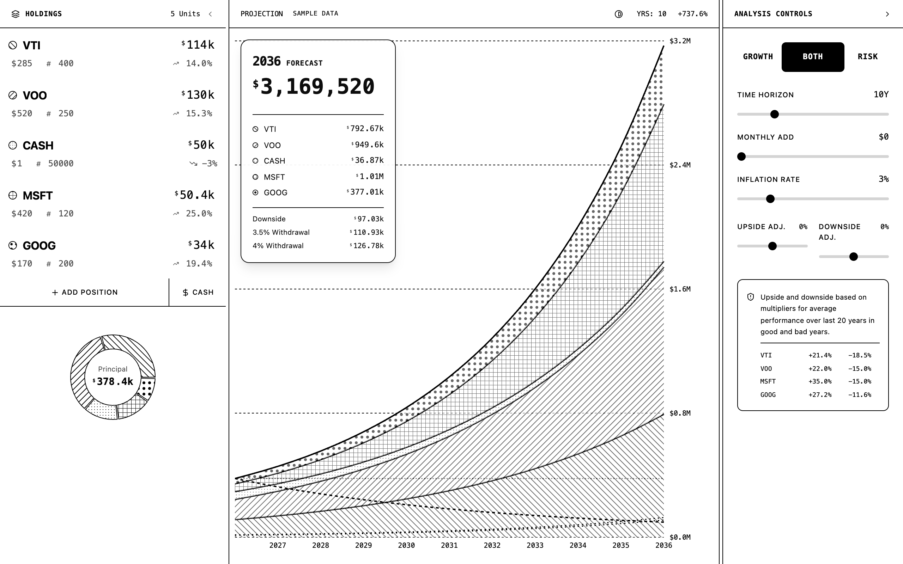
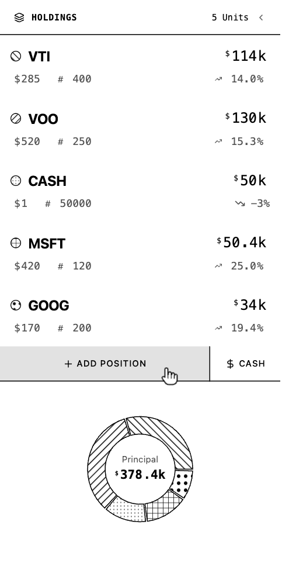
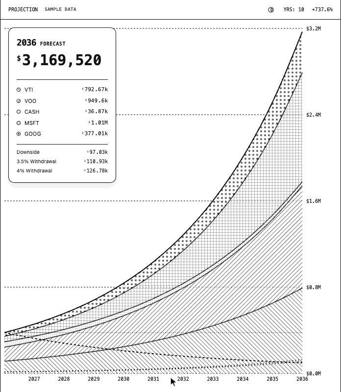
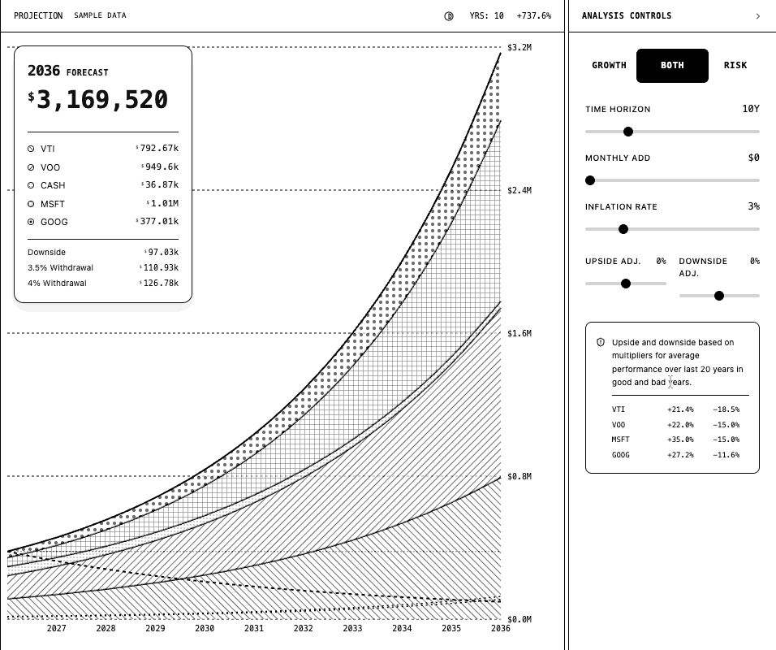
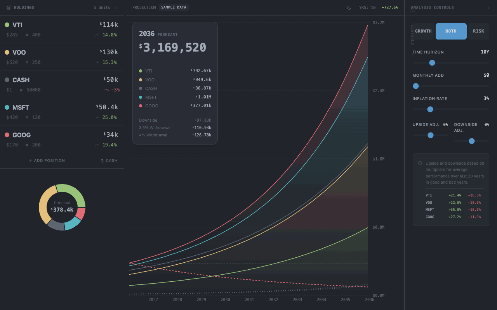

# `folio`

One-page investment forecast based on average past performance. What happens if things go well? What if it gets bad?

  
[<kbd> haaans.com/folio  </kbd>](https://haaans.com/folio/?theme=bw&data=fake)

## Features

<table>
<tr valign="top">
<td width="50%">
<h3>Quick controls</h3>

Drag by price or amount and use previous performance or worst/best years as a baseline.

</td>
<td width="50%">

</td>
</tr>
<tr valign="top">
<td width="50%">

</td>
<td width="50%">
<h3>Hover through time</h3>

Run across the chart and the forecast card follows you year by year: each holding, the downside case and what a 3.5% or 4% withdrawal would pay.

</td>
</tr>
<tr valign="top">
<td width="50%">
<h3>Growth or risk over time</h3>

Watch compounding take over, for ideal scenarios and base risk on previous bad years.

</td>
<td width="50%">

</td>
</tr>
<tr valign="top">
<td width="50%">

</td>
<td width="50%">
<h3>No database</h3>

Stores in local memory, so none of the data is stored anywhere outside of your own browser.

</td>
</tr>
</table>
