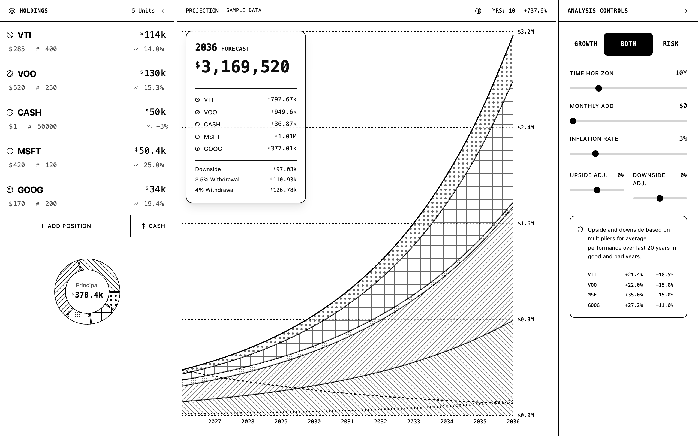
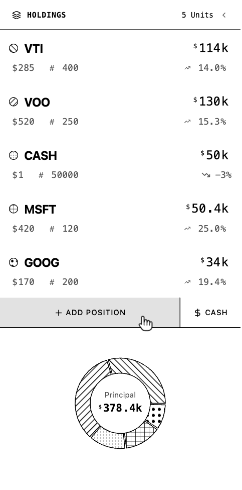
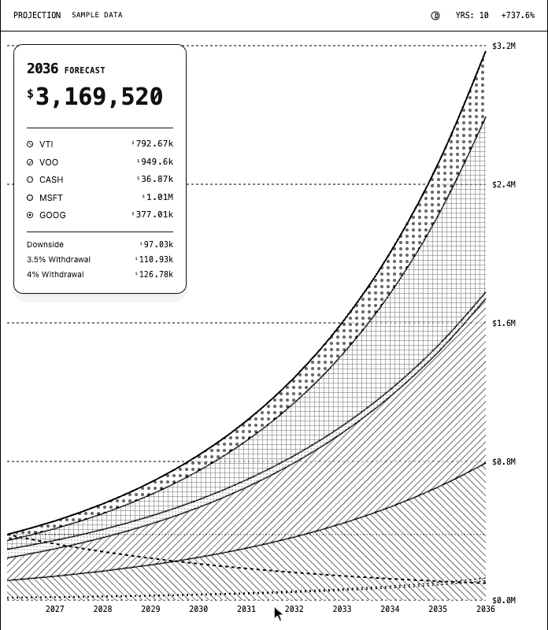
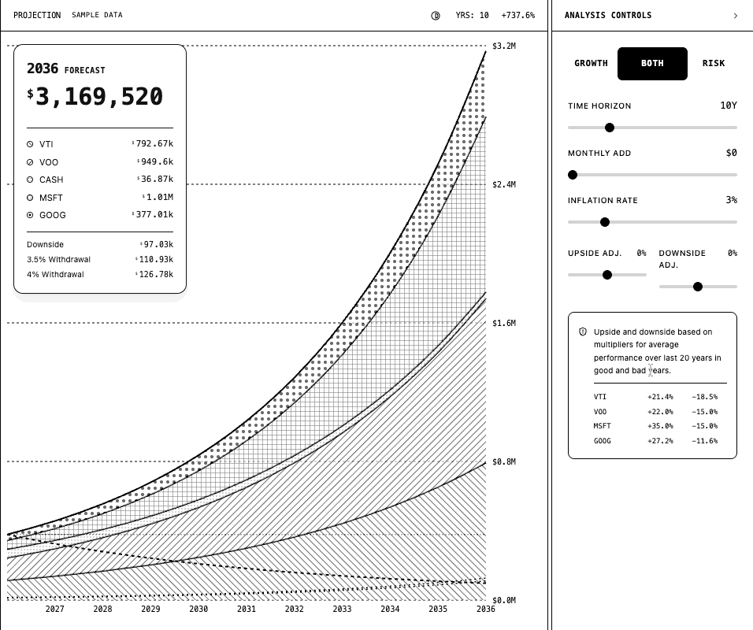
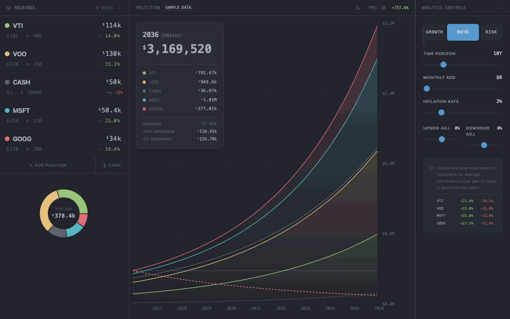

# `folio`

A dense, single-file portfolio forecaster. Drop in your holdings, then drag, scrub and hover to see where they could be in 10, 20 or 40 years.

  
[<kbd> haaans.com/folio  </kbd>](https://haaans.com/folio/?theme=bw&data=fake)

## Features

<table>
<tr valign="top">
<td width="50%">
<h3>Drag any number</h3>

Every value is a scrubber. Drag a position left or right and the shares, the allocation ring and the forecast all move with it. Click a number to type one instead.

</td>
<td width="50%">

</td>
</tr>
<tr valign="top">
<td width="50%">

</td>
<td width="50%">
<h3>Hover through time</h3>

Run across the chart and the forecast card follows you year by year: each holding, the downside case and what a 3.5% or 4% withdrawal would pay.

</td>
</tr>
<tr valign="top">
<td width="50%">
<h3>Stretch the horizon</h3>

Slide from 1 to 40 years and watch compounding take over. Monthly contributions, inflation and the upside and downside adjustments sit right beside it.

</td>
<td width="50%">

</td>
</tr>
<tr valign="top">
<td width="50%">

</td>
<td width="50%">
<h3>Growth, risk, or both</h3>

Switch between the stacked growth of each holding, the downside and withdrawal lines on their own, or both at once.

</td>
</tr>
<tr valign="top">
<td width="50%">
<h3>Share it without sharing it</h3>

Press <kbd>S</kbd> to swap your holdings for a sample portfolio, and cycle dark, light or black and white. Both live in the URL, so <code>?theme=bw&amp;data=fake</code> is a link you can send anyone.

</td>
<td width="50%">

</td>
</tr>
</table>
